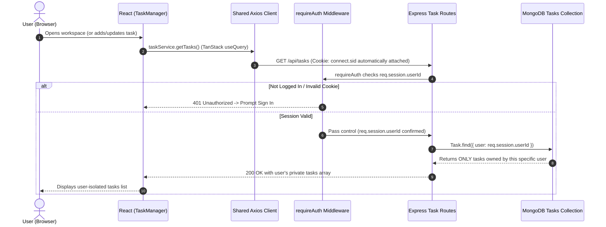
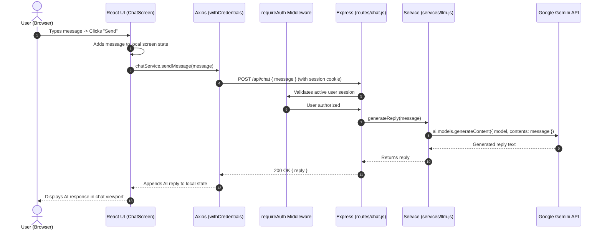

# TaskFlow - MERN Task Tracker (Phase 2: Accounts & Session-Based Authentication)

TaskFlow is a full-stack MERN application that provides secure, multi-user task tracking. Phase 2 introduces server-side session authentication with MongoDB storage, password hashing with bcrypt, strict server-side task ownership enforcement, and modern frontend state management with TanStack Query and Axios.

---

## Architecture & Request Flow Diagrams

### 1. User Registration & Sign-In Flow
```mermaid
sequenceDiagram
    autonumber
    actor User as User (Browser)
    participant React as React Frontend
    participant Axios as Shared Axios Client
    participant Express as Express API Server
    participant MongoStore as MongoDB Session Store
    participant DB as MongoDB Users Collection

    User->>React: Enters email and password -> Clicks "Sign In"
    React->>Axios: authService.login({ email, password })
    Axios->>Express: POST /api/auth/login (credentials: include)
    Express->>DB: User.findOne({ email })
    DB-->>Express: Returns user document with password hash
    Express->>Express: bcrypt.compare(password, hash)
    Express->>MongoStore: Creates session { userId: user._id }
    MongoStore-->>Express: Session saved in 'sessions' collection
    Express-->>Axios: 200 OK + Set-Cookie: connect.sid=...; HttpOnly; SameSite=Lax
    Axios-->>React: user data returned
    React->>React: TanStack Query cache updated (['currentUser'])
    React-->>User: Redirected to private task workspace
```

### 2. Loading & Managing Protected User Tasks Flow


---

## Key Concepts Explained

### 1. Server-Side Sessions with `connect-mongo`
* Unlike stateless JWTs (which require token handling on the client), Phase 2 uses **server-managed sessions**:
  1. When a user authenticates, a session document is created in the MongoDB `sessions` collection containing their `userId`.
  2. The server signs a session ID and sends it to the browser as an **HTTP-only cookie** (`connect.sid`).
  3. `httpOnly: true` prevents client-side JavaScript from accessing the cookie, protecting it against **Cross-Site Scripting (XSS)** token theft.
  4. With `credentials: true` on both the client (Axios `withCredentials: true`) and server (CORS `credentials: true`), the browser automatically sends this cookie on every subsequent request.

### 2. Strict Server-Enforced Task Ownership
* Client-side filtering is never trusted for security. Ownership is enforced directly in MongoDB queries:
  * **List**: `Task.find({ user: req.session.userId })`
  * **Create**: `new Task({ title, user: req.session.userId })`
  * **Update**: `Task.findOneAndUpdate({ _id: id, user: req.session.userId }, updateData)`
  * **Delete**: `Task.findOneAndDelete({ _id: id, user: req.session.userId })`
* **Security guarantee**: If User B attempts to update or delete User A's task by manually sending User A's task ID in an API request, MongoDB finds no matching document for `{ _id: id, user: req.session.userId }` and returns `404 Not Found / Unauthorized`.

---

## Environment Variables Configuration

Create a `.env` file in the root directory:

```env
PORT=5000
MONGO_URI=mongodb://127.0.0.1:27017/tasktracker
SESSION_SECRET=supersecret_session_key_tasktracker_phase2
CLIENT_URL=http://localhost:3000
```

| Variable | Description | Default |
| :--- | :--- | :--- |
| `PORT` | Port number for Express API backend | `5000` |
| `MONGO_URI` | Connection URI for MongoDB instance | `mongodb://127.0.0.1:27017/tasktracker` |
| `SESSION_SECRET` | Secret key used to cryptographically sign session cookies | (Required in production) |
| `CLIENT_URL` | Frontend origin allowed for CORS with credentials | `http://localhost:3000` |

---

## Setup & Running Instructions

### Prerequisites
* **Node.js** (v18 or higher recommended)
* **MongoDB** running locally on port 27017 or a MongoDB Atlas URI

### 1. Install Dependencies
```bash
# Install backend dependencies
npm install

# Install frontend dependencies
cd frontend
npm install
cd ..
```

### 2. Start the Backend Server
In the root directory:
```bash
npm start
# or for auto-reload:
npm run dev
```
You should see:
```text
🚀 Server running on http://localhost:5000
🔒 Session-based authentication enabled (Storage: MongoDB)
🌐 Accepting requests from: http://localhost:3000
✅ [MongoDB] Connected successfully!
```

### 3. Start the Frontend React App
In a new terminal window:
```bash
cd frontend
npm start
```
The application will open at `http://localhost:3000`.

---

## Verification & Testing (Multi-Account Isolation)

Follow these steps to confirm end-to-end functionality:

1. **Register Account 1 (e.g., Alice)**:
   * Select "Create Account", register with `alice@example.com` and password `password123`.
   * Add two tasks: `"Alice Task 1"` and `"Alice Task 2"`.
   * Verify they display in the list with `ID` and creation timestamps.
2. **Log Out**:
   * Click the **Logout** button in the header. The app immediately returns to the Sign In screen.
3. **Register Account 2 (e.g., Bob)**:
   * Register with `bob@example.com` and password `password123`.
   * Notice that the tasks list is completely **empty**. None of Alice's tasks are visible.
   * Add a task: `"Bob Task 1"`.
4. **Cross-User Protection Verification**:
   * Even if Bob knows Alice's task ID and attempts a manual `PUT` or `DELETE` request to `/api/tasks/<alice-task-id>`, the server returns `404 Not Found or access unauthorized` because the database query specifically searches for `{ _id: id, user: bob_id }`.
5. **Switch Back to Account 1**:
   * Log out of Bob and sign in as Alice.
   * Alice's tasks (`"Alice Task 1"`, `"Alice Task 2"`) remain intact and untouched.


---

## Phase 3: AI Chat Integration (Phase 1 - Stateless Gemini Assistant)

### Overview
Integrated Google Gemini (`gemini-2.5-flash`) into the app through a secure, authenticated backend endpoint.

### Request Flow

